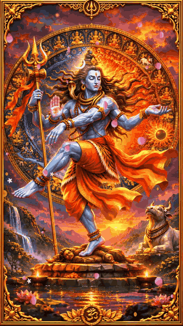
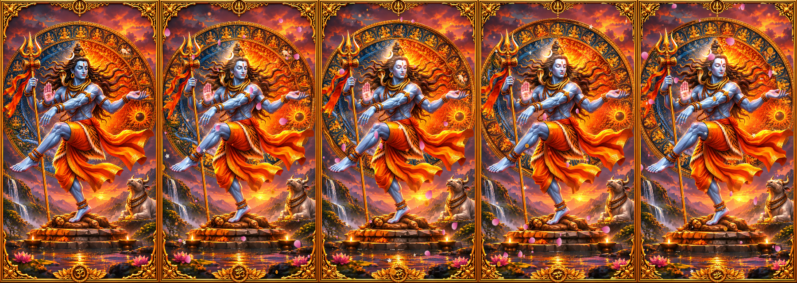

# image-to-reel

A Claude skill that turns **any still image** (devotional artwork, illustration, photo, landscape, portrait, product shot) into a **9:16 Instagram Reel / YouTube Short** with natural motion and synthesized sound.

Wind in cloth, rippling water, rotating halos, glowing eyes and lamps, falling petals, snow, embers, light rays, a slow camera push-in: all made from the single image you upload.

<p align="center">
  <a href="samples/shiva_reel_sample.mp4">
    
  </a>
  <br>
  <sub>One still painting, animated into a 14 s Reel. Click for the full video with sound
  (<a href="samples/shiva_reel_sample.mp4"><code>samples/shiva_reel_sample.mp4</code></a>).</sub>
</p>

> **No video model is used.** Every frame is composited from layers in Python/OpenCV and encoded with ffmpeg. The only ML step is Segment Anything (via `rembg`), used to cut out objects when needed. Output is deterministic, offline-capable and cheap to re-render.

---

## Table of contents

1. [What you get](#what-you-get)
2. [How it works (architecture)](#how-it-works)
3. [Repo layout](#repo-layout)
4. [Setup](#setup)
5. [The 7-step procedure](#the-7-step-procedure)
6. [Effect catalogue](#effect-catalogue)
7. [Examples](#examples)
8. [Hard-won rules](#hard-won-rules)
9. [Extending the engine](#extending-the-engine)
10. [Delivery and sound](#delivery-and-sound)
11. [FAQ](#faq)

---

## What you get

| Property | Default |
|---|---|
| Resolution | 1080 x 1920 (9:16) |
| Frame rate | 30 fps |
| Duration | 9-15 seconds |
| Container | MP4 (H.264) via ffmpeg |
| Audio | Synthesized (ambience / music / SFX) |
| Loop-friendly | Yes. Motion is periodic with integer cycles |

Typical trigger phrases:

- "Animate this image"
- "Make a Reel / Short from this"
- "Add wind, water motion, a flower shower, rotation or glow"

---

## How it works

```
 src.png
    |
    v
 inspect_image.py ---> overview / tiles / regions (coordinate grids)
    |
    v
 Inventory: every element + its motion class
    |
    v
 Isolation plan: polygon | color | grabcut | rembg | sam
    |
    v
 scene.json  (effects, positions in source pixels)
    |
    +--> segment.py   -> mattes (cut-outs)
    +--> polar_fill.py-> hidden parts of rotating patterns
    +--> audio.py     -> synthesized soundtrack
    |
    v
 render.py preview  (still frames, QC at 100 %)
    |
    v
 render.py full     (all frames, multi-worker)  --> qc.py --> final .mp4
```

Key ideas:

- **Layers, not generation.** The picture is split into the parts that must move independently (or sit in front of something that moves). Everything else stays as the original pixels.
- **Isolate only what you must.** Cut-outs are expensive and error-prone, so the skill always picks the cheapest isolation method that works.
- **Small, periodic motion.** Amplitudes are kept tiny so the result reads as "alive" rather than "warped". Faces never warp.
- **One full render per request.** All iteration happens on cheap preview stills.

---

## Repo layout

```
image-to-reel/
├── SKILL.md                  # the skill definition Claude loads
├── scripts/
│   ├── engine/
│   │   ├── core.py           # shared helpers (layers, compositing, easing)
│   │   ├── render.py         # preview / full renderer
│   │   └── effects.py        # effect classes (extend here)
│   └── tools/
│       ├── inspect_image.py  # overview, tiles, auto region guesses
│       ├── segment.py        # builds mattes from scene.json
│       ├── polar_fill.py     # fills hidden pattern for rotating rings
│       ├── fit_circle.py     # exact ring / halo centres
│       ├── audio.py          # synthesized sound
│       └── qc.py             # final quality check
├── references/
│   ├── FLOW.md               # step-by-step guide + pitfall table
│   └── EFFECTS.md            # every effect and its parameters
├── assets/
│   ├── scene_template.json   # skeleton for new scenes
│   └── example/              # worked example: src.png, shiva_scene.json, shiva_masks/
└── samples/
    ├── shiva_reel_sample.mp4 # the rendered result of the worked example (with sound)
    ├── shiva_reel_preview.gif # silent 7 s preview shown at the top of this README
    └── shiva_frames.png      # QC contact sheet: 5 frames across the 14 s
```

`S` below means the skill's own folder. Never work inside `S`; always create a fresh project folder.

---

## Setup

Once per session:

```bash
python3 -c "import cv2, scipy; cv2.ximgproc"
ffmpeg -version
```

If anything is missing:

```bash
pip install --break-system-packages \
  opencv-contrib-python-headless numpy scipy pillow rembg onnxruntime
```

`rembg` + `onnxruntime` are only needed for the `sam` and `rembg` matte methods.

---

## The 7-step procedure

### 1. Brief

Fix the format (1080x1920, 30 fps, 9-15 s). Record standing constraints, for example:

- the decorative golden frame stays perfectly still
- flowers fall through the scene
- an end card credit is appended

Choose **one hero effect**, **2-3 supporting effects**, then ambience.

### 2. Observe

```bash
cp my_image.png src.png
python3 $S/scripts/tools/inspect_image.py src.png inspect
```

Then actually look at `inspect/overview.png`, `tile_*.png` and `regions.png`. Auto-guesses are hints only: on painted art, circles are usually found but water and faces often are not. Read coordinates from the grids (they are in **source pixels**).

### 3. Inventory

List every element: where it is, whether it sits in front of something that will move, and its motion class.

### 4. Isolation plan

| Method | Use when |
|---|---|
| `polygon` | simple shape you can outline by hand |
| `color` | element has a distinct colour |
| `grabcut` | moderate contrast against surroundings |
| `rembg` | plain background |
| `sam` | complex objects; point prompts, in ~600 px strips |

Use `fit_circle.py` for exact ring centres, and `polar_fill.py` to reconstruct hidden parts of rotating patterns.

### 5. Write `scene.json`

Start from `assets/scene_template.json`. Positions are in source pixels. Keep amplitudes small (at 1080 wide):

| Motion | Typical amplitude |
|---|---|
| Wind / sway | 5-12 px |
| Water | 1-5 px |
| Sky drift | 4-7 px |
| Glow strength | <= 0.5 |
| Bloom threshold | >= 190 |

### 6. Build and QC loop

```bash
python3 $S/scripts/tools/segment.py scene.json       # then inspect work/mattes/*_overlay.png
python3 $S/scripts/tools/polar_fill.py scene.json    # only with a rotate_ring
python3 $S/scripts/tools/audio.py scene.json
python3 $S/scripts/engine/render.py scene.json preview 0 2.4 7 13   # stills at t = 0, 2.4, 7, 13 s
python3 $S/scripts/engine/render.py scene.json full --workers 2     # ~75 s per 14 s of video
python3 $S/scripts/tools/qc.py scene.json
```

When checking mattes, look for see-through limbs, halos and leaks into the frame.

### 7. Deliver

Send the MP4 with one line on what moves. Mention that the sound is synthesized and can be swapped for trending audio inside Instagram, and offer an end card.

---

## Effect catalogue

The skill maps image elements to effects:

| Element in the image | Effect |
|---|---|
| Sky, clouds | `sky_drift` |
| Lamp, eye, sun, jewel | `glow` |
| Light shafts | `rays` |
| Lake, sea | `water_ripple` |
| Waterfall, mist, smoke | `flow` |
| Wheel, halo, mandala | `rotate_ring` (+ `polar_fill`) |
| Cloth, flag, ribbon | `sway` (as an *object*) |
| Hair, grass not in a matte | `sway` (as a *composite*) |
| Hovering things | `bob` |
| Petals, snow, rain, embers, fireflies | `particles` (far layer behind, near layer in front) |
| Border, logo | `frame_lock` |
| Whole picture | `camera`, `bloom`, `vignette`, `grade` |

Full parameter lists live in `references/EFFECTS.md`.

---

## Examples

### Example 1: Devotional artwork with a golden frame

**Input:** Krishna-Radha painting inside an ornate golden border.
**Request:** "Keep the frame still, animate everything inside, add falling flowers."

Plan:

| Element | Effect | Notes |
|---|---|---|
| Golden border | `frame_lock` | Pasted last, so particles and glows pass *under* it |
| Sky / clouds | `sky_drift` | 4-7 px |
| Lamp / jewels / eyes | `glow` | strength <= 0.5 |
| Dupatta, flute ribbon | `sway` | isolate with `sam`, zero weight on rigid parts |
| Flowers | `particles` | far layer behind figures, near layer in front |
| Whole scene | `camera` push-in, `vignette`, `bloom` | threshold >= 190 |

Result: a 12-15 s Reel where only the interior breathes.

### Example 2: Landscape with a lake

**Input:** Mountain lake photo at sunset.

| Element | Effect |
|---|---|
| Lake | `water_ripple`, 1-5 px |
| Mist at the base | `flow` |
| Clouds | `sky_drift` |
| Sun | `glow` |
| Light shafts | `rays` |
| Whole frame | `camera` slow push-in, `grade` warm |

No cut-outs needed. This is the cheapest class of job: mostly region masks.

### Example 3: Deity with a rotating halo (prabhavali / chakra)

**Input:** Mahalakshmi or Ganesha with a circular halo.

1. Run `fit_circle.py` to get the exact halo centre.
2. Add `rotate_ring` for the halo.
3. Run `polar_fill.py` so the parts hidden behind the figure are reconstructed and the ring can turn without gaps.
4. If an orb or medallion sits *inside* the ring, make it a separate object with `lift:false`, a higher `z`, and `occluder_circles`.
5. Add `glow` on the eyes and ornaments, `particles` for petals.

### Example 4: Portrait or product shot

| Element | Effect |
|---|---|
| Hair strands | `sway` (composite) |
| Product highlight | `glow` or `rays` |
| Backdrop | `sky_drift` or slow `camera` |
| Face | **never warped** |

### Example 5: Snowy scene

Two `particles` layers: a small, slow far layer behind the subject and a larger near layer in front. Add `flow` for mist and a subtle `vignette`.

### Example 6: Bundled worked example (with sample output)

`assets/example/` contains a Shiva artwork with 22 effects that runs as is. Its rendered result is checked in at [`samples/shiva_reel_sample.mp4`](samples/shiva_reel_sample.mp4) (1080x1920, 30 fps, 14 s, 6.5 MB, compressed for the repo).



[Watch the full sample with sound](samples/shiva_reel_sample.mp4)

What moves in the sample: drifting sunset clouds, two rotating mandala rings (rebuilt with `polar_fill`), the orb held in front of them, swaying cloth and hair, a flowing waterfall and lake ripples, glows on the flames, eyes and ornaments, light rays, falling lotus, marigold and jasmine petals with a few embers, a slow camera push-in and bloom. The golden frame stays locked.

Reproduce it:

```bash
S=/path/to/image-to-reel            # this repo
mkdir -p ~/shiva_demo && cd ~/shiva_demo
cp $S/assets/example/src.png .
cp -r $S/assets/example/shiva_masks .
cp $S/assets/example/shiva_scene.json scene.json

python3 $S/scripts/tools/segment.py scene.json
python3 $S/scripts/tools/polar_fill.py scene.json
python3 $S/scripts/tools/audio.py scene.json
python3 $S/scripts/engine/render.py scene.json preview 0 7      # optional stills
python3 $S/scripts/engine/render.py scene.json full --workers 2 # ~75 s
python3 $S/scripts/tools/qc.py scene.json
```

The full render lands in `out/shiva_generic.mp4` (about 29 MB uncompressed; the repo copy was re-encoded with `ffmpeg -crf 27`).

---

## Hard-won rules

- **SAM prompts** go in the `sam_prompt=` kwarg. Other kwargs are silently ignored.
- **One SAM call per process.** More than one runs out of memory. Crop into strips.
- **No positive prompts** on hair or on the pattern that must rotate.
- **Missing bracelets or jewellery** in a matte let the background show through limbs. Fix with `global_close` / `local_close`.
- **Rigid parts** (poles, standing leg) need zero sway weight. Use `side`, `poly` or `keep_still_x`.
- **Object inside a rotating ring** = object with `lift:false`, higher `z`, plus `occluder_circles`.
- **The frame mask is always pasted last**, so particles and glows pass under it.
- **Amplitudes** stay small. Large motion looks like warping, not life.
- Known pitfalls and their fixes are tabulated at the end of `references/FLOW.md`.

---

## Extending the engine

If a request needs an effect the engine lacks:

1. Add a class in `scripts/engine/effects.py`. Its docstring lists the stage methods.
2. Keep motion **periodic with integer cycles** so the Reel loops cleanly.
3. List the new effect in your `scene.json`.

---

## Delivery and sound

- Audio is **synthesized** by `audio.py`, so there are no licensing issues.
- For Instagram, you can replace it with trending audio inside the app.
- An **end card** (for example "Film by @image_editorials") can be appended on request.

---

## FAQ

**Is this AI video generation?**
No. It is classical compositing with one segmentation model for cut-outs.

**Why not warp faces?**
Warping faces looks uncanny. Faces are kept rigid; motion is added around them.

**How long does rendering take?**
About 75 s per 14 s of video with 2 workers, after a few seconds per preview still.

**Can I use a landscape (16:9) image?**
Yes. It is composed into 9:16 via camera framing; check the preview stills for crop.

**Can I use my own music?**
Yes. Replace the synthesized track when posting, or mux your own audio with ffmpeg.
